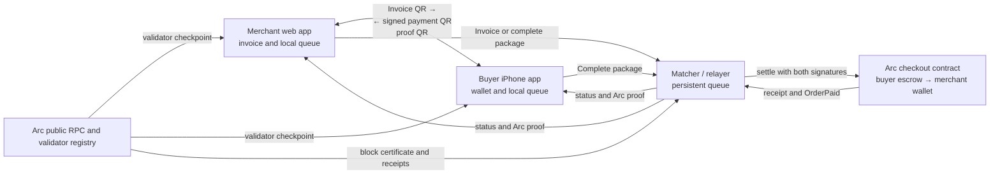

# Echo

Echo is an Arc Testnet checkout where a merchant and buyer exchange signed QR codes while both devices are offline. Either device can later reconnect and submit the payment. A signed QR means **pending**; only Arc settlement means **paid**.

## System architecture



The merchant app signs invoices and saves sales in browser storage. The buyer app keeps its wallet in iOS Keychain and saves signed orders on the phone. Both cache the checkout configuration and an Arc validator checkpoint while online. The QR exchange itself needs no network connection.

The matcher accepts signed intents, keeps a durable queue, submits settlement transactions, and serves status and proof data. Its funded wallet pays the settlement network fee; it does not hold either user's signing key or escrow. The contract holds the buyer's prepaid native test USDC, checks both signatures, and pays the merchant wallet directly.

### Payment and intent flow

1. **Prepay.** While online, the buyer deposits Arc Testnet USDC into the checkout contract. The buyer can withdraw its own escrow balance and keeps some USDC in the wallet for deposit and withdrawal fees.
2. **Create invoice.** The merchant signs an EIP-712 `Receive` intent with a fresh 16-byte order ID, merchant address, amount, and deadline. The QR also names the Arc chain and checkout contract. New invoices have a 24-hour deadline.
3. **Approve payment.** The buyer scans the invoice, verifies the merchant signature, reviews the terms, and signs a `Send` intent for the same ID, merchant, amount, and deadline plus its own payer address. The phone checks its cached escrow balance minus locally pending orders before signing. Its return QR carries **both** signed intents as a payment package.
4. **Match locally.** The merchant scans the return QR and checks both signatures against its saved invoice. Both devices now hold the complete package. They remain pending until Arc settles it.
5. **Upload from either side.** On reconnection, either device posts the complete package to the matcher. The merchant may also upload its invoice alone earlier; a separate buyer upload is unnecessary once either side submits the package.
6. **Settle on Arc.** The matcher checks the signatures and terms and calls `settle` with both signatures. The contract enforces the deadline, cancellation and replay state, escrow balance, and exact signers. It debits buyer escrow, transfers USDC to the merchant, and emits `OrderPaid`.
7. **Confirm.** The online device gets the settled status and a proof. It can show animated proof QR frames to the still-offline device, which verifies the payment before showing Completed.

The EIP-712 signing domain remains `Blackout Checkout` version `2` in the deployed contract and clients. Echo is the product name; changing the domain would invalidate signatures.

### Queues and states

Both apps save signed orders locally before upload and retry when online. The merchant uses browser storage, and the buyer persists orders on the phone. Clearing browser storage or removing the iPhone app removes that device's local queue. The buyer's cached balance helps prevent oversigning but does not reserve funds on chain; the contract checks the actual escrow balance at settlement.

The matcher stores its queue in `runtime/matches.json` by default, keyed by merchant address and order ID. It serializes queue operations and writes through a temporary file rename. `/api/intents` accepts a single signed intent; `/api/package` accepts both. Conflicting terms or signatures for an existing order are rejected. A processing pass runs after uploads and every 10 seconds. It checks Arc cancellation, prior settlement, and buyer funds, submits a transaction, then watches its receipt. A stored transaction hash prevents duplicate submission while that transaction is pending.

| State | Meaning |
| --- | --- |
| Local / waiting | A signed intent exists, but the payment has not settled. |
| Matched | Both signatures reached the matcher; settlement is next. |
| Awaiting funds / retrying | Escrow is short or submission failed; the matcher retries before expiry. |
| Submitted | Transaction sent; Arc confirmation is pending. |
| Settled | Successful Arc receipt for the payment. |
| Expired / cancelled / failed | The current payment cannot complete. |

An unscanned invoice can be cancelled online with a merchant-signed `Cancel` intent. The matcher records the cancellation on chain, so direct settlement cannot bypass it. Once a buyer payment is received, this cancellation flow is closed. The contract prevents a paid order from being replayed. Anyone can relay valid signatures, but cannot change their terms or redirect the payout.

### Proof on the offline device

After settlement, `/api/settlement-proof` builds a proof from the Arc block certificate, block header, transaction receipt, and receipt inclusion path. The online app displays it across animated QR frames. The offline app reassembles them, verifies validator precommits with more than two-thirds voting power, checks the block hash and height and receipt inclusion, and matches the successful `OrderPaid` log to its locally saved signatures. A transaction hash or matcher status alone is not offline proof.

Before disconnecting, both apps compare the matcher's validator checkpoint with Arc's public RPC and cache it. The checkpoint covers the next 1,800 blocks. This testnet demo assumes the validator set stays unchanged in that window; it does not prove validator-set transitions. Verification fails outside the cached window.

## Run and demo

Use Node 22 or newer:

```sh
npm ci
npm run compile
npm run build
CHECKOUT_ADDRESS=0xd132eA8D7cADD65B92be0B616Ae65Bbf6F0Af037 MATCHER_PRIVATE_KEY_FILE=/path/to/matcher-key npm start
```

The matcher serves the merchant app at `http://localhost:4173` by default. It uses `ARC_RPC` (default `https://rpc.testnet.arc.io`); `MATCHER_STATE_FILE` changes the queue path. Keep the funded matcher key outside the repository. The [hosted demo](https://blackout-next.64-177-121-208.sslip.io/) uses this checkout flow.

Open the merchant app online once to cache its assets and validator checkpoint. Back up its recovery key in Settings before clearing browser storage. Open the [iPhone project](ios/BlackoutBuyer.xcodeproj) in Xcode, select a phone and signing team, and Run; see [iOS setup](ios/README.md). Fund the buyer from Circle's Arc Testnet faucet, then use **Add → Deposit to Arc escrow** while online.

To demo: prepare escrow, disconnect both devices, create and scan an invoice, approve it on iPhone, and scan the return QR on the merchant device. Reconnect **either** device to settle. Show its animated proof QR to the offline device for verification.

The active contract is [`0xd132eA8D7cADD65B92be0B616Ae65Bbf6F0Af037`](https://explorer.testnet.arc.io/address/0xd132eA8D7cADD65B92be0B616Ae65Bbf6F0Af037). Funds in the [earlier escrow](https://explorer.testnet.arc.io/address/0x38929cCE8c5914755587d41Bf78B9ccC401AAc4d) do not move automatically; the iPhone app shows that balance separately and offers **Move** while online.

Run `npm test` and `forge test` for the intent, matcher, proof, and contract checks. The [queued payment plan](OFFLINE_PAYMENT_PLAN.md) without prepaid escrow is future work.
